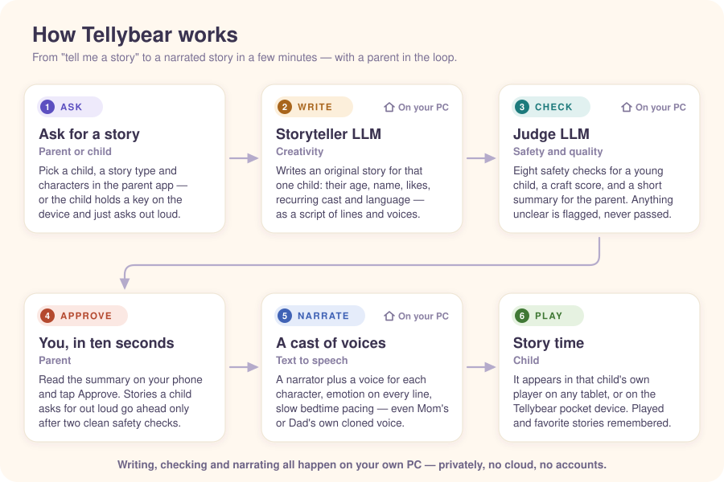

# Tellybear 🧸

**A bedtime story teller you build and customize yourself for your kids.**

My son wanted a new bedtime story every night, and I ran out of characters. So I designed it with him
and built it with AI (local and frontier): I (or he) ask for a story, an LLM on my home lab writes
it, another LLM checks it for safety and writes me a short summary, I approve it, and it's
narrated — a narrator plus a different voice for each character — and plays in a web player on
any tablet, or on a $40 ESP32 pocket device he can operate himself. It all runs locally and
privately on my own PC.

This repo is everything you need to build your own. It's a hobby project. Please read the
[DISCLAIMER](DISCLAIMER.md) before you build one for a kid.

---

## Why it's built this way

It started from what my son wanted, and every design choice is based on minimal, private, creative and fun:

- **He asks, and the story is there.** He holds a key and says "a story about a sleepy 
  cat", or I tap a few options in the app. A few minutes later it's playing. No browsing, no ads,
  no "pick from 500 stories".
- **My part takes ten seconds.** A second LLM reads every story before I do and writes a
  one-paragraph summary plus any safety flags. I read that on my phone and tap Approve. I don't have
  to read every word of every story to know it's fine for my kid.
- **Everything else runs on its own.** Queue "tonight" stories in the afternoon; in the evening
  they're written, checked, narrated and waiting. The worker, the nightly batch and a watchdog
  run unattended.
- **Local and private.** The LLMs, the voices (TTS), the database and the audio all live on my own
  PC. My kids' names, voices they like, what they ask for and the recordings of my voice never leave
  the house. No accounts, no cloud, no subscription. (A cloud model is supported, but off by
  default.)
- **Different kid, different story tellers.** Same story teller may not fit for every kid, and one story
  doesn't fit all of them. Each child gets stories written for them — see below.

## A story teller for each child

Every child has their own profile, and each story is written for that one child:

- **Age band.** *Early* (3–5): short sentences, soft repetition, one tiny problem, a small cast.
  *Older* (6–8): richer vocabulary, a slightly bigger arc. The safety judge also checks the story
  against the child's age.
- **They're the hero.** Their name, their pronouns, and notes you add ("loves robots, trains, scared
- of thunder") go into every prompt. Add a brother or sister as a character and they turn up in each
  other's stories.
- **Their own world.** Recurring characters you create or that the story invents. Turn on
  "continue the series" and the cast carries over, building a little world over many nights.
- **Never the same story twice.** Each child's recent stories are fed back as "don't repeat
  these", and a similarity check rewrites a story that comes out too close to one they've
  already heard.
- **Their language and voice.** English or Hindi/Hinglish per child. Pick a narrator per child,
  including a cloned parent voice.
- **Their own player.** Each child has a private player link (and optionally a device), with their
  own played/unplayed list, favorites, and a "your story is ready" announcement in their name.
- **House rules for everyone.** A family list of banned words (with optional replacements, e.g.
  "gun" → "water blaster"), custom pronunciations for names the voice gets wrong, and a daily
  story limit.

## A narrator with a cast of voices

Stories are written as a script of lines, not one block of text, so they're performed rather than
read out:

- **A narrator plus a voice per character.** Up to three voices per story, so the tugboat, the
  big ship and the narrator each sound different.
- **Emotion on every line.** The story model tags each line (curious, playful, tender, relieved,
  sleepy…) and, with Chatterbox, the delivery follows it, calming down toward the end.
- **Bedtime pacing.** A slower reading speed for younger kids, pauses between sentences, and
  longer pauses through the wind-down, so it ends sleepy rather than abruptly.
- **Mom or Dad can narrate.** Record about 30 seconds of yourself reading (there's a consent box,
  and the recording stays private on your PC). Your cloned voice can narrate a child's stories, or speak the lines of a character
  called Mom or Dad. Cloned voices keep a more natural pace, because a parent's voice slowed down sounds off.
- **Two engines.** [Chatterbox](https://github.com/devnen/Chatterbox-TTS-Server) (GPU,
  expressive, cloning, multilingual) or [Kokoro](https://github.com/remsky/Kokoro-FastAPI) (CPU,
  lighter). Kokoro is also the fallback if Chatterbox is down.

## What the two LLMs do

Tellybear uses two roles, ideally two different models: a **storyteller** and a **judge**. Any
OpenAI-compatible endpoint works, and you pick both models from a dropdown in the app.

**The storyteller is there for creativity.** It writes an original story for one child as a
structured script: title, cast, lines with speakers and emotions, a moral and a summary. To keep it
from settling into the same cozy garden every night, the prompt:

- offers a fresh handful of settings and story sparks each time, drawn from about 46 very
  different places (harbors, night markets, sky-ships, deserts, snowy villages…) and 23 sparks;
- asks for one emotional core, a refrain the child can say along with, a small surprise and a
  slow ending;
- forbids formula titles and copyrighted characters (no Bluey).

Overnight it writes three versions of each story and keeps the best safe one.

**The judge is there for safety and quality.** First, plain code checks the structure and runs a
banned-word backstop. Then, for every story, the judge model:

1. reviews the story across eight categories: violence, scary, distressing, inappropriate,
   unsafe behavior, vocabulary for the age, calm ending, copyrighted characters. Anything but a
   clean "ok" is a flag, and a judge error counts as a fail;
2. scores the craft (and optionally does one editing pass);
3. writes the summary you approve from.

Stories your child asks for out loud are judged twice and only skip your approval when both
passes are clean. More in [`tellybear/safety/README.md`](tellybear/safety/README.md).

**How long a story runs** once narrated:

| Kind | Length | Listening time |
|---|---|---|
| Early (3–5) | about 430 words | about 3–4 minutes |
| Older (6–8) | about 450–650 words | about 4–5 minutes |
| Long "epic" (optional) | about 2,000 words in 6 chapters, written chapter by chapter | about 15 minutes |

## How it works



1. **Ask.** In the parent app pick a child, a story type (adventure, friendship, bravery, bedtime
   calm, curiosity, kindness), characters, an optional special request, and "now" or "tonight". Or
   the child holds a key on the Tellybear device and asks out loud; speech-to-text runs locally.
2. **Write.** The storyteller writes the story for that child.
3. **Check.** The judge checks it, scores it and summarizes it.
4. **Approve.** The story waits in the **Review** tab with its summary and any flags (plus a phone
   notification if you set up [ntfy](https://ntfy.sh)). Approve, reject with a reason, or regenerate.
5. **Narrate.** The worker voices the script line by line and makes an MP3.
6. **Play.** It appears in that child's player and on their device.

## What's in the repo

| Path | What |
|---|---|
| [`tellybear/`](tellybear/) | the backend — FastAPI API, worker, safety pipeline, TTS |
| [`prompts/`](prompts/) | every prompt: generation, safety judge, craft judge, editor, long-form |
| [`web_parent/`](web_parent/) | the parent app (React PWA) — Review · New · Names · Kids · Admin |
| [`web_child/`](web_child/) | the child player — big buttons, no text input, works offline |
| [`firmware/cardputer/`](firmware/cardputer/) | **optional** Tellybear device firmware (ESP32-S3) |
| [`examples/stories/`](examples/stories/) | four reference stories to try the flow without an LLM |
| [`Dockerfile`](Dockerfile), [`docker-compose.yml`](docker-compose.yml) | the Docker setup (app, worker, scheduler, Kokoro) |
| [`systemd/`](systemd/) | services for running without Docker |
| [`migrations/`](migrations/) | database schema (SQLite via Alembic) |

## Build your own

### What you need

- **An OpenAI-compatible LLM endpoint**: [llama-swap](https://github.com/mostlygeek/llama-swap)
  or llama.cpp, Ollama, vLLM, LM Studio, LiteLLM, or a hosted provider (`TB_LLM_API_KEY`). One
  model writes the stories, and ideally a second, stronger one judges them. A 12B-class model writes
  decent stories; give the judge the strongest model you can. I run llama-swap on a 16 GB GPU.
- **Text-to-speech**: [Kokoro-FastAPI](https://github.com/remsky/Kokoro-FastAPI) (light, runs on
  CPU, bundled in the Docker setup) and/or
  [Chatterbox-TTS-Server](https://github.com/devnen/Chatterbox-TTS-Server) (GPU, more expressive,
  parent voice cloning).
- **Docker** — or, to run it without Docker, Python 3.12+ and Node 18+.
- Optional: an [ntfy](https://ntfy.sh) topic for "ready to review" pushes, and an M5Stack Cardputer
  ADV for the [Tellybear device](firmware/cardputer/README.md).

### Run it with Docker (recommended)

```bash
git clone https://github.com/sanjaygulati13/kids-story-teller.git && cd kids-story-teller
cp .env.example .env      # set TB_LLM_URL (+ TB_LLM_API_KEY if needed) and TB_ADMIN_EMAIL
docker compose up -d
docker compose logs api | grep -A1 "Admin login"     # your generated password (first run)
```

That starts four containers: the app (`api`), the `worker` that writes, checks and narrates
stories, a `scheduler` for the nightly batch, and `kokoro` for narration. Everything is stored in
the `tellybear-data` volume.

Open `http://<this machine>:8090/parent` and sign in. Then, in the app:

1. **Admin** — pick the story model and the judge model from your gateway's model list, the TTS
   engine, voice and server URLs, and the daily story limit.
2. **Kids** — rename the first child (it starts as "Sam"), set the age band, copy the player link.
3. **New** — ask for a story.

Only the gateway and the admin email live in `.env`; every other setting in it is optional (see the
comments). A gateway on the same machine is reachable as `http://host.docker.internal:<port>/v1`.
Set `TZ` (e.g. `TZ=America/Los_Angeles`) so the nightly batch runs at your local evening.

Handy commands:

```bash
docker compose run --rm api python scripts/import_stories.py --child Sam examples/stories/
docker compose run --rm api python scripts/gen_announcements.py       # device "story ready" clips
git pull && docker compose up -d --build                              # update
```

For Chatterbox, run Chatterbox-TTS-Server on a GPU machine, then in **Admin** enter its URL (e.g.
`http://gpu-box:8890`), press **Check connection**, and switch the engine to Chatterbox. TTS server
URLs can also be preset in `.env` (`TB_CHATTERBOX_URL`, `TB_KOKORO_URL`); the Admin tab overrides
them.

### Or run it without Docker

```bash
git clone https://github.com/sanjaygulati13/kids-story-teller.git && cd kids-story-teller
cp .env.example .env              # set TB_LLM_URL and TB_ADMIN_EMAIL (+ TB_KOKORO_URL etc.)
./run.sh --quick                  # venv, deps, migrate, seed, build the parent app, unit tests
./run.sh --serve                  # API + worker in the foreground
```

`run.sh` runs `scripts/seed.py`, which creates your admin account and prints a generated password
once (or set `TB_ADMIN_PASSWORD`), plus a first child profile.

**GPU juggling.** Without Docker, the worker assumes by default that the LLM and Chatterbox share one
GPU and swaps them in and out (llama-swap + `rocm-smi` + a systemd Chatterbox service). On any
other setup — NVIDIA, CPU-only, a remote endpoint — set `TB_GPU_HANDOFF=false`. If your models fit
in VRAM together, `TB_GPU_CORESIDENT=true` skips the swap and is faster.

For an always-on install, copy `systemd/*.service` and `systemd/*.timer` to
`~/.config/systemd/user/` (they expect the repo at `~/kids-story-teller`; edit the paths if yours
lives elsewhere), then `systemctl --user enable --now tellybear-api tellybear-worker
tellybear-batch.timer tellybear-watchdog.timer`.

### Try it with the reference stories

```bash
docker compose run --rm api python scripts/import_stories.py --child Sam examples/stories/
# without Docker: .venv/bin/python scripts/import_stories.py --child Sam examples/stories/
```

Use your child's name if you've renamed them. Four hand-written stories land in **Review**. Approve one, the worker narrates it, and it plays in
the child player — the whole loop without generating anything. See
[`examples/stories/`](examples/stories/README.md).

### Check the safety judge before you trust it

```bash
docker compose run --rm api python scripts/run_judge_eval.py
# without Docker: .venv/bin/python scripts/run_judge_eval.py
```

Runs your judge model over a red-team set of deliberately unsafe stories and fails if any slips
through. Run it a few times, especially before relying on auto-approved voice requests.

### Optional: the Tellybear device

A pocket player on an M5Stack Cardputer ADV: Enter plays a story, hold Space to ask for one,
arrows for volume and skip, a hidden parent screen. Flashing guide in
[`firmware/cardputer/README.md`](firmware/cardputer/README.md), controls in
[`MANUAL.md`](firmware/cardputer/MANUAL.md).

## Security notes for self-hosters

- Built for a **home LAN**. If you expose it (reverse proxy, tunnel), serve it over HTTPS and set
  `TB_COOKIE_SECURE=true`.
- Signup is **invite-only** by default: the admin is created by the seed script, co-parents are
  added from the app.
- Treat a child's player link (`/play/<code>`) like a password: anyone with it can play that child's
  stories and send voice requests (rate-limited). If one leaks, **Kids → New link** revokes it.
- Notifications include your child's name and the story title. On the public ntfy.sh server, topics
  are readable by anyone who knows them and messages pass through ntfy's servers. Pick a long random
  topic, or self-host ntfy to keep everything at home.

## Known limitations

- The worker and the nightly batch are separate processes with no shared GPU lock; approving a
  story while a batch is running on a shared GPU can fail that story (re-approve it).
- The watchdog treats any job busy for 15+ minutes as stalled, which can catch a very long
  "epic" story mid-narration.
- Hindi stories get the LLM judge but not the English banned-word backstop.
- The parent and child apps load their fonts from Google Fonts.

## License

Code is [MIT](LICENSE). Please read the [DISCLAIMER](DISCLAIMER.md) — hobby project, no warranty,
not a certified toy, not for resale. Build one for your own kid and enjoy it.
